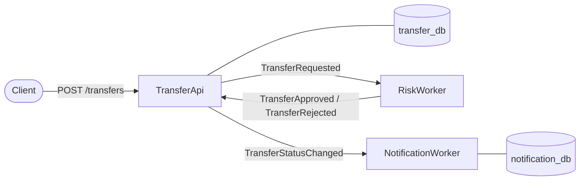

# Money Transfer Microservices

An event-driven money transfer system built with .NET 8, PostgreSQL and RabbitMQ, and runnable with Docker Compose or Kubernetes.

A client creates a transfer through a REST API. A risk service approves or rejects it, the transfer's status is updated, and a notification is stored. The services never call each other directly or share a database: they only communicate through events on RabbitMQ.

## Architecture



| Service | Type | Responsibility |
|---|---|---|
| **TransferApi** | ASP.NET Core Web API | Creates transfers, stores them in its own database, publishes `TransferRequested`. Consumes the risk decision, updates the status and publishes `TransferStatusChanged`. |
| **RiskWorker** | Worker service | Applies the risk rule (amounts over 10,000 are rejected) and publishes `TransferApproved` or `TransferRejected`. Has no database. |
| **NotificationWorker** | Worker service | Consumes `TransferStatusChanged` and stores a notification for the customer in its own database. |
| **Contracts** | Class library | The event records shared by the services. Nothing else. |

## Design decisions

- **Transactional outbox.** Saving a transfer and publishing its event happen in one database transaction (MassTransit's Entity Framework outbox). This avoids the dual-write problem: a transfer is never saved without its event, and an event is never sent for a transfer that wasn't saved. The same applies inside consumers, so a status change and its `TransferStatusChanged` event are committed together.
- **Notify only after the status is saved.** NotificationWorker reacts to `TransferStatusChanged`, published by TransferApi, not to the risk decision itself. If updating the status fails, no event exists and the customer is never told about a change that didn't happen.
- **Idempotent consumers.** RabbitMQ delivers messages *at least once*, so the same event can arrive twice. A unique index on the transfer id, plus handling of the resulting duplicate-key error, guarantees one notification per transfer, even when two copies are processed at the same time.
- **Retries and error queues.** Temporary failures, such as a database being briefly unavailable, are retried. Invalid data fails straight away and goes to an `_error` queue instead of being retried for nothing.
- **Database per service.** Each service owns its data and schema (EF Core code-first migrations). Data moves between services only through events.
- **Migrations as a separate step.** Services don't change the database structure at startup. A migration bundle runs once before them, so several copies of a service never migrate at the same time.
- **Money and time.** Amounts are `decimal` / `numeric(18,2)`, never floating point. All dates are UTC.

## Tech stack

- .NET 8, C#, ASP.NET Core
- PostgreSQL 16, Entity Framework Core 8 with Npgsql, snake_case naming
- RabbitMQ 4 with MassTransit 8
- xUnit, Testcontainers, MassTransit test harness
- Docker, Docker Compose, Kubernetes

## Running it

Both options need [Docker Desktop](https://www.docker.com/products/docker-desktop/). First, create the local settings file with your own development credentials:

```powershell
cp .env.example .env   # then fill in the values
```

`.env` is git-ignored. Database migrations run as a separate step before the services start: a one-off container in Compose, a Job in Kubernetes. Both use an EF Core migration bundle.

### Option 1: Docker Compose

```powershell
docker compose up -d --build
```

| What | Where |
|---|---|
| Swagger | http://localhost:8081/swagger |
| RabbitMQ management UI | http://localhost:15672 (credentials from `.env`) |

Stop everything with `docker compose down`. Your data stays in Docker volumes.

### Option 2: Kubernetes (Docker Desktop)

Turn on Kubernetes in Docker Desktop (Settings → Kubernetes, cluster type **Kubeadm**), then build the images and deploy:

```powershell
docker build -f src/TransferApi/Dockerfile -t transfer-api .
docker build -f src/RiskWorker/Dockerfile -t risk-worker .
docker build -f src/NotificationWorker/Dockerfile -t notification-worker .
docker build -f src/TransferApi/Dockerfile --target migrations -t transfer-api-migrations .
docker build -f src/NotificationWorker/Dockerfile --target migrations -t notification-worker-migrations .

kubectl apply -f k8s/namespace.yaml
kubectl create secret generic money-transfer-secrets -n money-transfer --from-env-file=.env
kubectl apply -f k8s/

kubectl get pods -n money-transfer
```

Swagger: http://localhost:30081/swagger

PostgreSQL and RabbitMQ run as StatefulSets with persistent storage. The three services run as Deployments, with passwords read from a Kubernetes Secret. Two Jobs apply the database migrations. Until they finish, the services may restart a few times, which is expected. Remove everything, including the data, with `kubectl delete namespace money-transfer`.

Run one option at a time: both start the full system, and running them together doubles the load on the machine.

## Trying it out

```http
POST /transfers
Content-Type: application/json

{
  "fromAccount": "NL01BANK0001",
  "toAccount": "NL02BANK0002",
  "amount": 50.00,
  "currency": "EUR"
}
```

The response is `201 Created` with status `Pending`. A moment later, `GET /transfers/{id}` shows `Approved`. With an amount over 10,000, it shows `Rejected` with the reason.

## Tests

```powershell
dotnet test money-transfer-microservices.slnx
```

Docker must be running: the integration tests start their own PostgreSQL and RabbitMQ containers with Testcontainers.

| Project | Covers |
|---|---|
| `TransferApi.UnitTests` | Transfer validation and status rules |
| `TransferApi.IntegrationTests` | The API with a real database and RabbitMQ, the outbox, status updates, and that a failed update publishes no event |
| `RiskWorker.UnitTests` | The risk rule, including the 10,000 boundary, and the consumer |
| `NotificationWorker.IntegrationTests` | Notifications, duplicate messages, unknown statuses, and the unique-index fallback for duplicate inserts |

## Project structure

```
src/
  TransferApi/            REST API, consumers, EF Core migrations
  RiskWorker/             risk rule and consumer
  NotificationWorker/     consumer, EF Core migrations
  Contracts/              shared event records
tests/                    unit and integration tests
k8s/                      Kubernetes manifests
docker-compose.yml        full system with Docker Compose
docs/learning-notes.md    step-by-step notes written while building the project
```

## Not production-ready yet

This is a portfolio project. Before real use, it would need:

- authentication on the API
- Swagger restricted (it's currently enabled in every environment)
- real email delivery for notifications (they're currently only stored)
- images pushed to a container registry, instead of built locally
